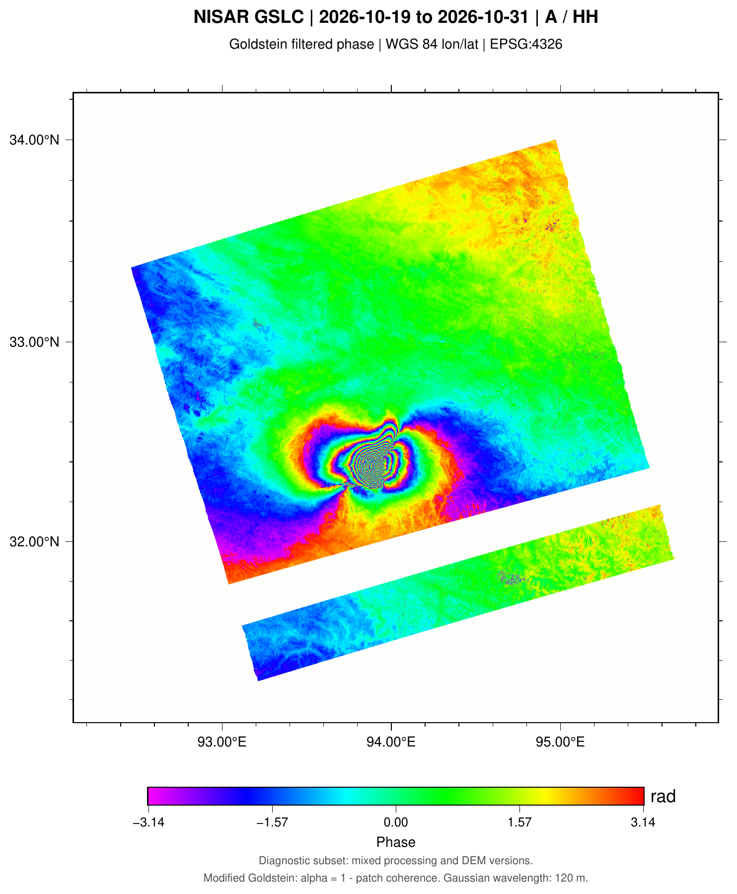
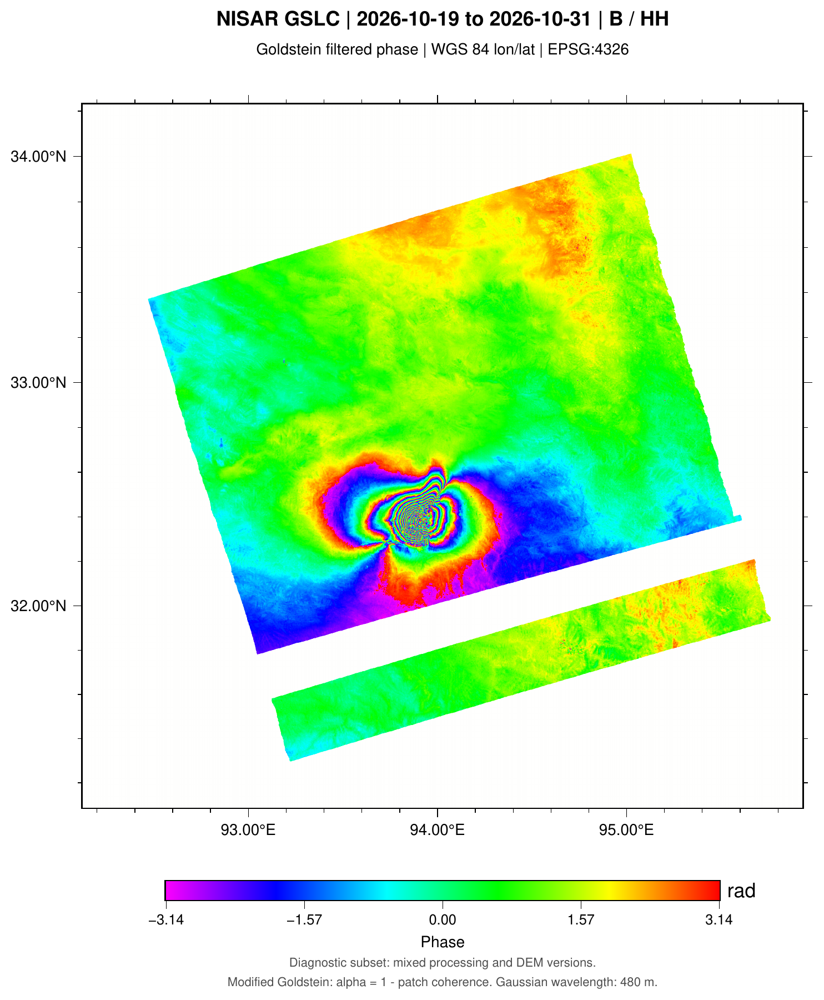
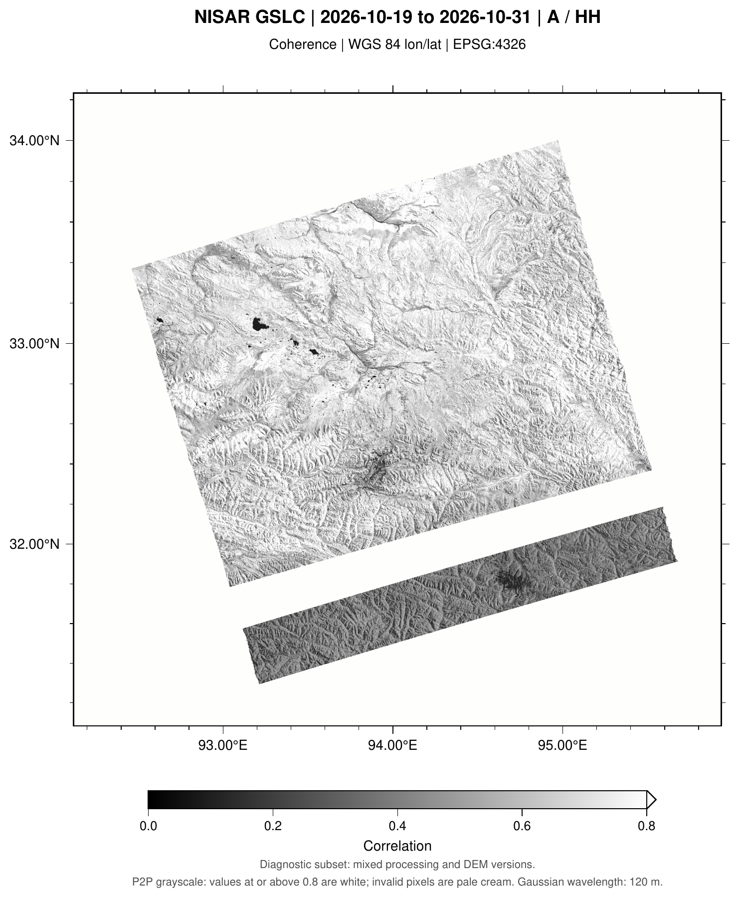
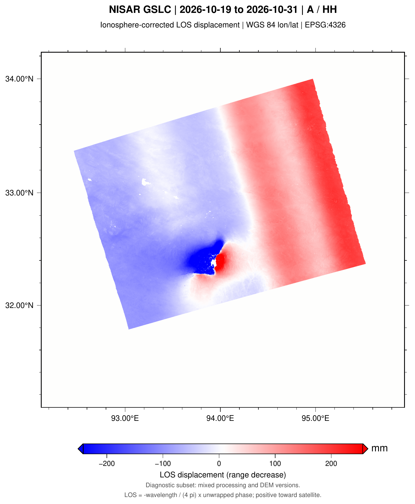
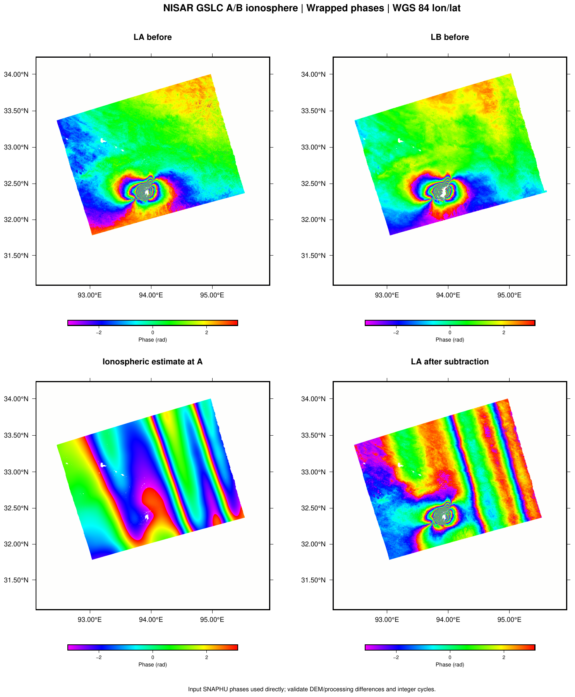
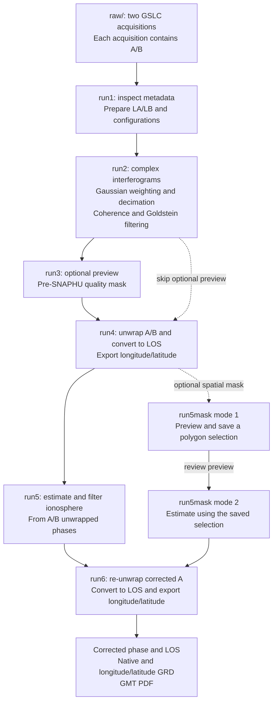

# NISAR GSLC DInSAR and Ionospheric Correction

**English** | [简体中文](README.zh-CN.md)

**Author and maintainer (GSLC workflow):** [Xin Wang](https://github.com/Xin-Wang-520)  
**Affiliation:** University of Science and Technology of China (USTC), Hefei, China  
**Contact:** [xinw11@mail.ustc.edu.cn](mailto:xinw11@mail.ustc.edu.cn)

See [authors and acknowledgments](AUTHORS.md) for upstream method and code credits.
The standalone development repository is
[gmtsar-nisar-gslc-dinsar-workflow](https://github.com/Xin-Wang-520/gmtsar-nisar-gslc-dinsar-workflow).

Version **0.6.5**. A standalone, configuration-driven workflow for two NISAR
GSLC HDF5 acquisitions: frequency A/B interferometry, coherence, filtering,
unwrapping, A/B ionospheric estimation, and corrected A re-unwrapping.

Processing uses the GSLC map grid and metadata directly. Input HDF5 files are
read-only. The code calls an existing GMTSAR/GMT/SNAPHU installation and is
separate from the original GMTSAR and RSLC processing scripts.

## Example products

GSLC A/B HH products for **2026-10-19 to 2026-10-31**, shown in WGS 84
longitude/latitude. Click a figure to view it at full size.

| A: Goldstein-filtered wrapped phase | B: Goldstein-filtered wrapped phase |
| --- | --- |
| [](docs/images/a_phase.png) | [](docs/images/b_phase.png) |

| A coherence | Corrected A LOS after re-unwrapping |
| --- | --- |
| [](docs/images/a_coherence.png) | [](docs/images/a_corrected_los.png) |

The original A/B figures retain the full valid footprint. The masked branch
excludes the detached southern strip from ionospheric estimation and the
corrected A result. The following four panels show wrapped A/B input phases,
the A-frequency ionospheric estimate, and A after subtraction.

[](docs/images/ionosphere_comparison.png)

These are development examples, with mixed processing/DEM versions and an
inherited phase datum. They illustrate the processing outputs; scientific
validation is still required as described below.

## Workflow



The recommended all-stage script runs the ordinary run1–run6 path, including
run3. The polygon branch is a separate choice after run4, with a preview before
estimation. The diagram uses [GitHub-supported Mermaid syntax](https://docs.github.com/en/get-started/writing-on-github/working-with-advanced-formatting/creating-diagrams).

## Requirements and input

- Python **3.9+**: NumPy, SciPy, h5py, netCDF4, pyproj and rasterio.
- Existing GMTSAR `phasefilt`, SNAPHU **2.x**, GMT **6** and Ghostscript (`gs`).
  The shell entry points also require `csh`.
- Optional `pdftoppm` for PNG previews of geographic figures.
- Exactly **two compatible NISAR GSLC `.h5` files** in `raw/`; symbolic links
  are supported. Each acquisition should contain A/B. Templates use **HH**.

From the root of `gmtsar/user-contributions`, first run `cd nisar_gslc`.
All commands below run from this package directory. Activate your existing
SAR environment. Install missing Python dependencies if needed and check:

```bash
python -m pip install -r requirements.txt
python -c 'import numpy,scipy,h5py,netCDF4,pyproj,rasterio; print("Python dependencies OK")'
command -v csh phasefilt snaphu gmt gs
export NISAR_GSLC_PYTHON="$(command -v python)"

mkdir -p raw
# Put the two GSLC .h5 files, or links to them, in raw/.
ls raw/*.h5
```

The acquisition order comes from metadata. Without a diagnostic `--bbox`,
processing covers the full common map-grid extent, with invalid pixels masked.

## Recommended: run all six stages

For a new project, review the templates in `configs/` first, then run:

```bash
nohup ./run1-6_gslc_all.csh > run1-6_gslc_all.log 2>&1 &
tail -f run1-6_gslc_all.log
```

The controller waits for each stage and stops on failure. Detailed logs are
saved in `logs/all_UTC_TIMESTAMP_PID/run1.log` through `run6.log`.
The ordinary corrected A output is `LA_iono_corrected/`.

To edit project settings before processing, prepare first, then continue:

```bash
./run1_prepare_GSLC_LA_LB.csh
# Edit LA/config_GSLC_A.txt, LB/config_GSLC_B.txt and config_IONO.txt.
nohup ./run1-6_gslc_all.csh --from-step 2 > run2-6.log 2>&1 &
```

Preparation preserves configurations in an already prepared matching project.
Use a new project to change sampling or front-end filtering after run2 outputs
exist. With `--project /path/to/project`, data can live outside the code
folder; put the inputs in that project's `raw/`.

## Alternative: individual stages

Run each command after the previous one finishes. Pause after preparation to
edit configurations and after unwrapping to inspect results.

```bash
./run1_prepare_GSLC_LA_LB.csh
./run2_process_GSLC_LA_LB.csh
./run3_presnaphu_GSLC_LA_LB.csh
./run4_unwrap_GSLC_LA_LB.csh
./run5_iono_GSLC_LA_LB.csh
./run6_corrected_GSLC_LA.csh
```

| Stage | Work |
| --- | --- |
| run1 | Read `raw/`, inspect metadata, create LA/LB and configurations |
| run2 | Complex interferograms, Gaussian weighting, decimation, coherence and adaptive Goldstein |
| run3 | Preview the quality mask before SNAPHU; optional for manual execution |
| run4 | Unwrap A/B, convert directly to LOS, export native and geographic products |
| run5 | Combine A/B unwrapped phases and filter the ionospheric estimate |
| run6 | Re-unwrap corrected A, without repeating Gaussian/Goldstein filtering |

## Alternative: call Python directly

The numbered `.csh` files are thin entry points to the same Python dispatcher.
They are optional. These commands use the same configurations and perform the
same corresponding stages:

```bash
python gslc_workflow.py prepare
# Edit the generated LA/LB and ionosphere configurations here.
python gslc_workflow.py process
python gslc_workflow.py preview  # Optional
python gslc_workflow.py unwrap
python gslc_workflow.py iono
python gslc_workflow.py correct
```

Each command must succeed before the next starts. The recommended
`run1-6_gslc_all.csh` adds sequential execution, per-stage logs and automatic
stopping on failure. Direct calls use the active `python` and still require
the same numerical tools.

## Default parameters

| Parameter | A / HH | B / HH |
| --- | --- | --- |
| Output spacing, east × north | 40 × 40 m | 120 × 120 m |
| Gaussian wavelength | 120 m | 480 m |
| Goldstein mode | Coherence-adaptive | Coherence-adaptive |
| Goldstein patch | 32 × 32 output pixels | 32 × 32 output pixels |
| Unwrapping coherence threshold | 0.1 | 0.1 |
| SNAPHU mode | Smooth | Smooth |
| Full-scene tiles, north × east | 4 × 4 | 2 × 2 |
| Overlap, north/east | 512 / 512 output pixels | 512 / 512 output pixels |
| Simultaneous SNAPHU tile processes | 2 | 2 |
| Provisional effective looks | 32 | 8 |

The ionospheric filter wavelength is **20,000 m**; A prefiltering on the B grid
uses **1,000 m**. These defaults came from the development diagnostic pair and
should be reviewed for another scene. B is coarser for ionospheric estimation.
Grid spacing, Gaussian wavelength and effective spatial resolution differ.

Templates are in `configs/`. After preparation, active settings are in
`LA/config_GSLC_A.txt`, `LB/config_GSLC_B.txt` and `config_IONO.txt`.
See the [workflow guide](WORKFLOW_GSLC.md) for changes and polygon masking.

## Outputs

```text
raw/                         # Two input acquisitions
LA/intf/<pair>/              # A grids and figures; lonlat/ contains *_ll.grd
LB/intf/<pair>/              # B grids and figures; lonlat/ contains *_ll.grd
iono_correction/            # Ionospheric estimate, corrected A, lonlat/
LA_iono_corrected/           # Corrected A re-unwrapping, LOS, lonlat/
gslc_project.json            # Pair and map extent
logs/                       # Per-stage logs from the all-stage controller
```

**GRD is the primary format.** Native grids retain the product CRS; run4–run6
also export WGS 84 longitude/latitude GRD by default. GeoTIFF is optional.
Phase is in radians; LOS grids are in metres and LOS figures in millimetres.
Conversion is `LOS = -wavelength / (4*pi) * unwrapped_phase`, positive toward
the satellite, with no reference area or constant subtraction by default.
The inherited phase datum therefore remains in the LOS values.

GMT figures have unshaded colors and bottom colorbars. Run4 reuses the four
unchanged native run2 figures, draws unwrapped phase and LOS, and updates the
complete PDF bundle. Missing or stale plots are regenerated. Geographic
figures and corrected run6 figures are drawn separately.

## Interpretation and validation

- Grid matching uses GSLC map coordinates. Amplitude registration is a
  diagnostic check; automatic subpixel coregistration is not implemented.
- Processing or flattening-DEM version differences can leave residual signals.
- Unwrapping cycle errors and disconnected-region offsets can enter the A/B
  ionospheric estimate. Tiled connected-component labels remain tile-local.
- Successful execution is not scientific validation. Inspect phase continuity
  and preservation of deformation before quantitative use of the correction.

## Documentation and implementation

- [Workflow and parameters](WORKFLOW_GSLC.md) · [中文流程说明](WORKFLOW_GSLC.zh-CN.md)
- [Server use and recovery](SERVER_RUN.md) · [中文服务器说明](SERVER_RUN.zh-CN.md)
- `gslc_workflow.py`: orchestration; `make_intf_nsr_gslc.py`: GSLC reading and
  interferometry; `iono_gslc.py`: ionospheric estimation.
- `plot_gslc_gmt.py` and `reproject_gslc.py`: figures and geographic exports.
- `gslc_pair.py` / `.csh`: auxiliary pair inspection/full-pair processing. The
  recommended six-stage workflow includes ionospheric correction.

The GSLC adaptation follows Xin Wang's earlier
[RSLC workflow](https://github.com/Xin-Wang-520/gmtsar-nisar-dinsar-workflow).
See [provenance and attribution](UPSTREAM_PROVENANCE.md) and [GNU GPL v3](LICENSE).
