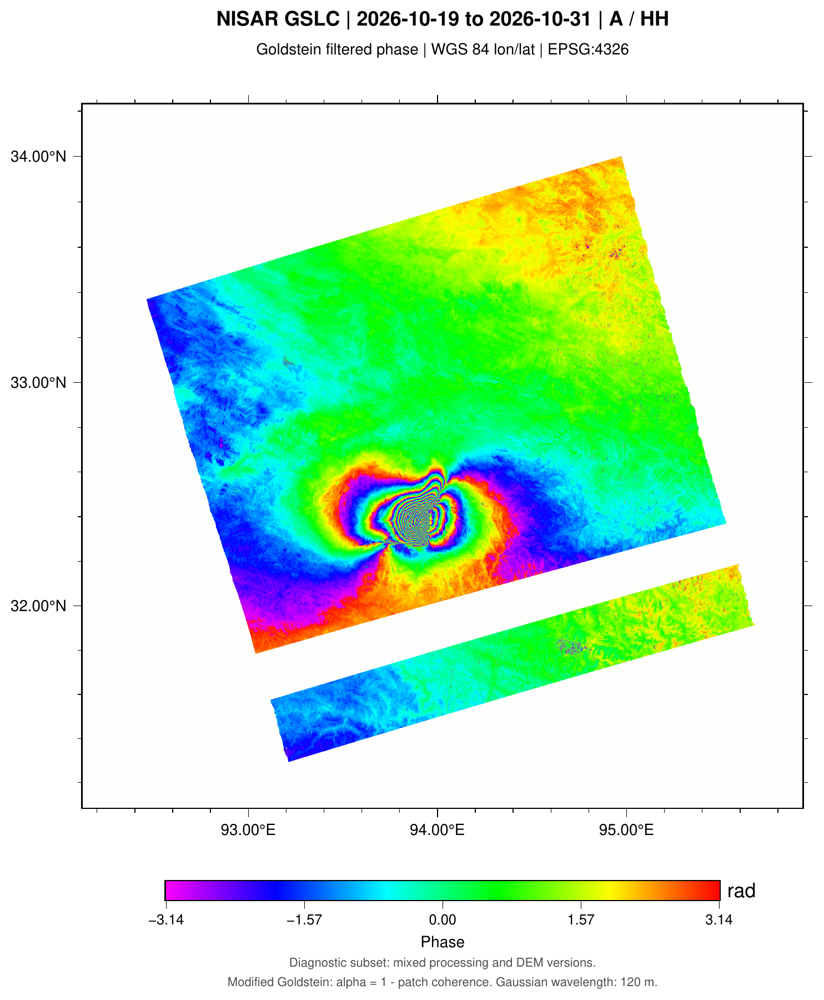
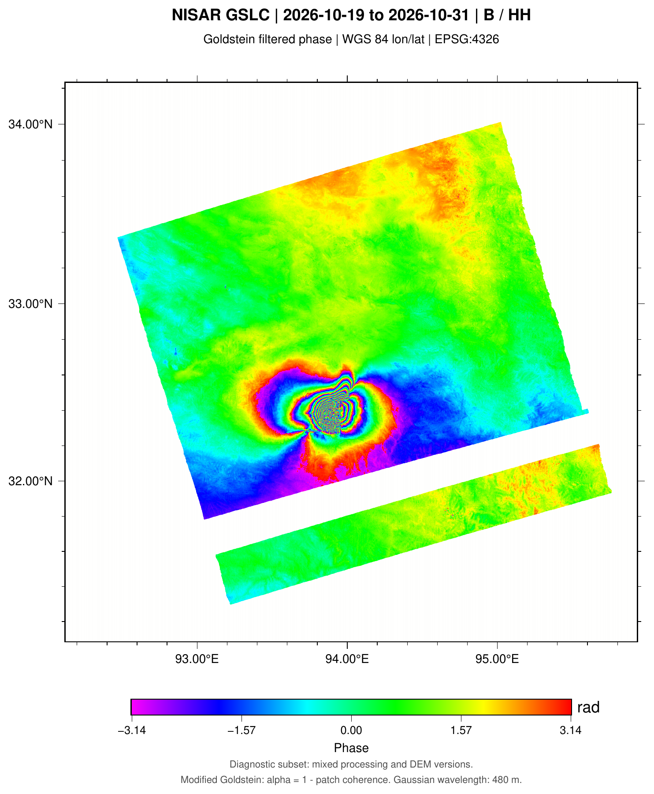
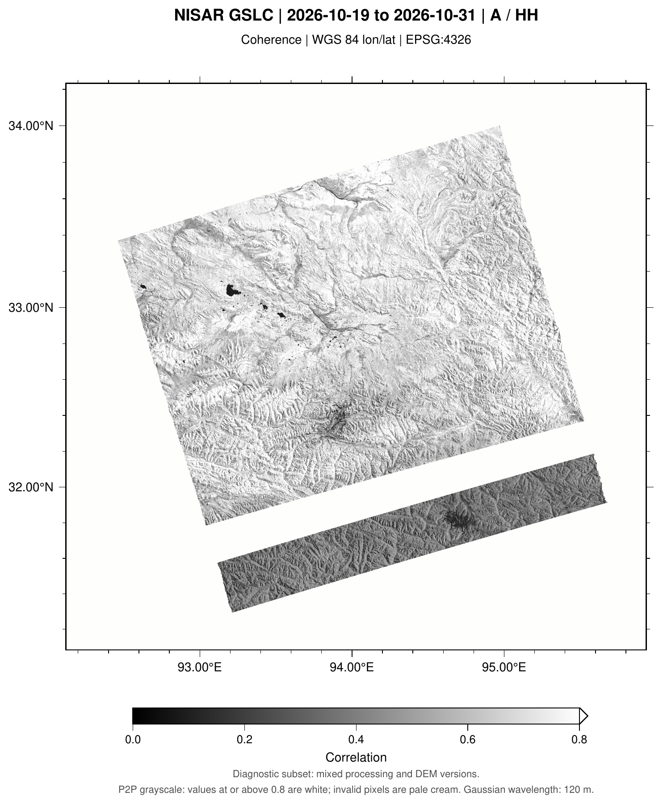
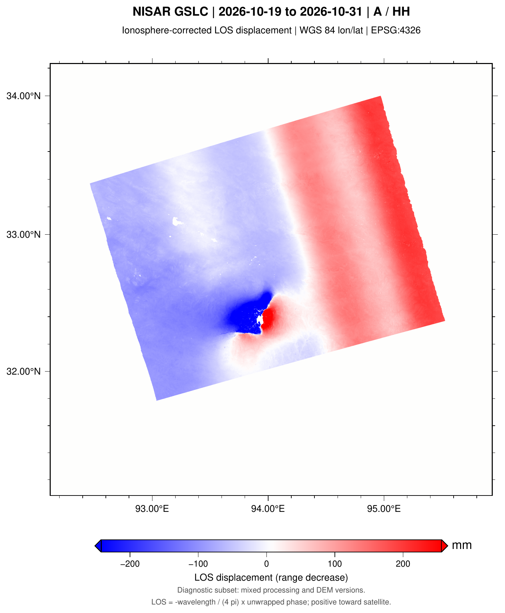
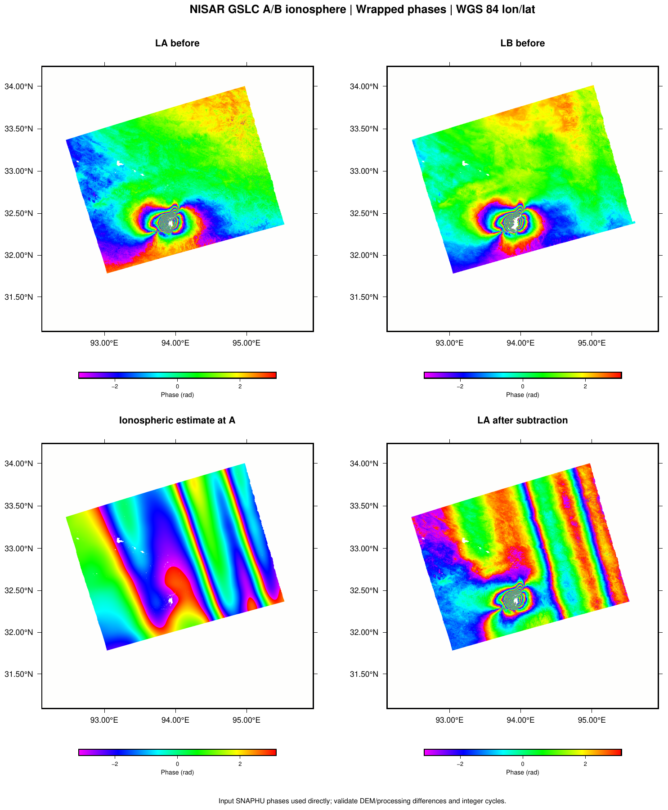
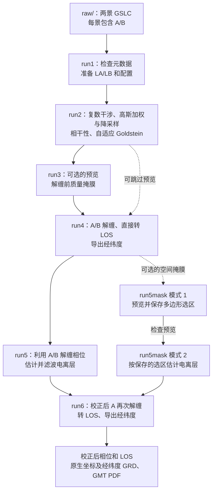

# NISAR GSLC 差分干涉与电离层校正

[English](README.md) | **简体中文**

**作者与维护者（GSLC 工作流）：** [Xin Wang](https://github.com/Xin-Wang-520)  
**单位：** 中国科学技术大学（USTC），中国合肥  
**联系邮箱：** [xinw11@mail.ustc.edu.cn](mailto:xinw11@mail.ustc.edu.cn)

上游方法和代码署名见[作者与致谢](AUTHORS.md#中文说明)。
独立开发与维护仓库为
[gmtsar-nisar-gslc-dinsar-workflow](https://github.com/Xin-Wang-520/gmtsar-nisar-gslc-dinsar-workflow)。

当前版本 **0.6.5**。本程序读取两景 NISAR GSLC HDF5，完成 A/B 干涉、相干性估计、
滤波和解缠，再利用 A/B 解缠相位估计电离层，对 A 校正后再次解缠。

处理直接使用 GSLC 自带的地图网格和元数据，输入 HDF5 只读，调用已有的
GMTSAR、GMT、SNAPHU，不修改原 GMTSAR 安装和 RSLC 处理脚本。

## 结果示例

**2026-10-19 至 2026-10-31** 的 GSLC A/B HH 结果，使用 WGS 84 经纬度坐标。
点击图片可以查看原图。

| A：Goldstein 滤波包裹相位 | B：Goldstein 滤波包裹相位 |
| --- | --- |
| [](docs/images/a_phase.png) | [](docs/images/b_phase.png) |

| A 相干性 | 校正后 A 再次解缠的 LOS |
| --- | --- |
| [](docs/images/a_coherence.png) | [](docs/images/a_corrected_los.png) |

原始 A/B 图保留完整有效覆盖区；掩膜分支在电离层估计及校正后 A 结果中剔除了南侧断开的条带。
下面四幅图依次展示 A/B 输入包裹相位、A 频率电离层估计，以及 A 扣除估计后的包裹相位。

[](docs/images/ionosphere_comparison.png)

这些开发示例存在处理版本和 DEM 版本差异，并保留输入相位零点，用于展示处理输出；
定量使用前仍需按后文说明验证。

## 处理流程



推荐的一键脚本执行普通 run1–run6 路径，包含 run3。多边形 mask 分支在 run4 后手动选择，
便于先看图再计算。流程图使用 [GitHub 支持的 Mermaid 语法](https://docs.github.com/en/get-started/writing-on-github/working-with-advanced-formatting/creating-diagrams)。

## 环境与输入

- Python **3.9+**，依赖 NumPy、SciPy、h5py、netCDF4、pyproj、rasterio。
- 已有的 GMTSAR `phasefilt`、SNAPHU **2.x**、GMT **6**、Ghostscript（`gs`）。
  Shell 入口还需要 `csh`。
- `pdftoppm` 为可选工具，用于经纬度图的 PNG 预览。
- `raw/` 中放入且仅放入**两景兼容的 NISAR GSLC `.h5`**，也支持软链接。
  每景应包含 A/B；当前配置模板使用 **HH** 极化。

在 `gmtsar/user-contributions` 根目录先执行 `cd nisar_gslc`。以下命令均在该包目录运行。
激活已有 SAR 环境；缺少 Python 依赖时再安装：

```bash
python -m pip install -r requirements.txt
python -c 'import numpy,scipy,h5py,netCDF4,pyproj,rasterio; print("Python dependencies OK")'
command -v csh phasefilt snaphu gmt gs
export NISAR_GSLC_PYTHON="$(command -v python)"

mkdir -p raw
# 把两景 GSLC .h5 或指向它们的软链接放入 raw/。
ls raw/*.h5
```

成像先后由元数据确定。不指定诊断范围 `--bbox` 时，处理整幅共同地图网格范围，
无效像元按掩膜剔除。

## 推荐方式：一键运行 run1–run6

新项目先检查 `configs/` 中的模板，再执行：

```bash
nohup ./run1-6_gslc_all.csh > run1-6_gslc_all.log 2>&1 &
tail -f run1-6_gslc_all.log
```

总控逐步等待，前一步成功才运行下一步，失败立即停止。各步完整日志位于
`logs/all_UTC时间戳_PID/run1.log` 至 `run6.log`。普通流程最终 A 结果在 `LA_iono_corrected/`。

如果想先修改项目配置，可以先准备，再从第二步一键继续：

```bash
./run1_prepare_GSLC_LA_LB.csh
# 编辑 LA/config_GSLC_A.txt、LB/config_GSLC_B.txt、config_IONO.txt。
nohup ./run1-6_gslc_all.csh --from-step 2 > run2-6.log 2>&1 &
```

对已准备好且输入一致的项目，run1 保留已编辑的配置。已有 run2 结果后，改变采样或前端滤波参数，
应新建项目重跑。代码与数据分开时使用 `--project /path/to/project`，输入放在该项目的 `raw/`。

## 其他方式：逐步运行

每条命令完成后再执行下一条；准备后可以改配置，解缠后可以检查结果再继续。

```bash
./run1_prepare_GSLC_LA_LB.csh
./run2_process_GSLC_LA_LB.csh
./run3_presnaphu_GSLC_LA_LB.csh
./run4_unwrap_GSLC_LA_LB.csh
./run5_iono_GSLC_LA_LB.csh
./run6_corrected_GSLC_LA.csh
```

| 步骤 | 工作 |
| --- | --- |
| run1 | 读取 `raw/`，检查元数据，建立 LA/LB 和配置 |
| run2 | 复数干涉、高斯加权、降采样、相干性、自适应 Goldstein |
| run3 | SNAPHU 前的质量掩膜预览；手动运行时可跳过 |
| run4 | A/B 解缠、直接转 LOS，生成原生坐标和经纬度结果 |
| run5 | 组合 A/B 解缠相位并滤波电离层估计 |
| run6 | 校正 A 后再次解缠，不重复高斯和 Goldstein 滤波 |

## 其他方式：直接调用 Python

编号 `.csh` 只是调用同一 Python 调度程序的入口，**也可以不用这些 Shell 脚本**：

```bash
python gslc_workflow.py prepare
# 在这里编辑生成的 LA/LB 和电离层配置。
python gslc_workflow.py process
python gslc_workflow.py preview  # 可选
python gslc_workflow.py unwrap
python gslc_workflow.py iono
python gslc_workflow.py correct
```

两种方式使用相同配置，对应步骤执行相同计算。直接调用时要自己确认上一条成功完成；
推荐的 `run1-6_gslc_all.csh` 自动控制顺序、保存每步日志，并在失败时停止。
直接调用使用当前环境的 `python`，仍需要相同的数值处理工具。

## 默认参数

| 参数 | A / HH | B / HH |
| --- | --- | --- |
| 输出网格间距，东西 × 南北 | 40 × 40 m | 120 × 120 m |
| 高斯滤波波长 | 120 m | 480 m |
| Goldstein 模式 | coherence，相干性自适应 | coherence，相干性自适应 |
| Goldstein 窗口 | 32 × 32 输出像元 | 32 × 32 输出像元 |
| 解缠相干性阈值 | 0.1 | 0.1 |
| SNAPHU 模式 | smooth | smooth |
| 整幅分块，南北 × 东西 | 4 × 4 | 2 × 2 |
| 分块重叠，南北/东西 | 512 / 512 输出像元 | 512 / 512 输出像元 |
| 同时求解的 SNAPHU 块数 | 2 | 2 |
| 临时有效视数 | 32 | 8 |

电离层滤波波长默认 **20,000 m**，A 匹配到 B 网格后的预滤波波长为 **1,000 m**。
默认值来自开发时的诊断数据对，用于其他场景前应检查。B 使用较粗网格用于电离层估计；
**网格间距、高斯波长和有效空间分辨率是不同概念**。

模板在 `configs/`；准备后实际读取 `LA/config_GSLC_A.txt`、`LB/config_GSLC_B.txt`、
`config_IONO.txt`。改参数和可选多边形 mask 见[详细流程](WORKFLOW_GSLC.zh-CN.md)。

## 输出结果

```text
raw/                         # 两景输入 GSLC
LA/intf/<pair>/              # A 网格和图；lonlat/ 存放 *_ll.grd
LB/intf/<pair>/              # B 网格和图；lonlat/ 存放 *_ll.grd
iono_correction/            # 电离层估计、校正后 A、lonlat/
LA_iono_corrected/           # 校正 A 后再次解缠、LOS、lonlat/
gslc_project.json            # 配对信息和地图范围
logs/                       # 一键总控生成的分步日志
```

**GRD 是主要输出格式**。原生网格保留产品 CRS；run4–run6 默认另外输出 WGS 84 经纬度 GRD。
GeoTIFF 按需导出。相位单位为 radian，LOS 网格单位为 m，图上为 mm。
直接换算为 `LOS = -波长 / (4*pi) × 解缠相位`，朝卫星为正，默认不选参考区、不减常数，
因此 LOS 仍继承输入解缠相位的零点。

GMT 图不加梯度阴影，colorbar 在下方。run4 复用 run2 的四张未变化的原生坐标图，
只新增解缠和 LOS 图，再更新完整 PDF 图集；缺失或过时的图自动补画。
经纬度图和 run6 改正后图单独绘制。

## 结果解释与验证

- 按 GSLC 地图坐标匹配；振幅配准检查用于诊断，尚未实现自动亚像元配准。
- 不同处理版本或 flattening DEM 可能残留相位信号。
- 解缠整周错误和断开区域的相位偏移可能进入 A/B 电离层估计；分块连通域编号仍是块内标签。
- 流程运行完成不代表电离层场已获科学验证；定量使用前应检查相位连续性和形变是否保留。

## 文档与主程序

- [详细流程与参数](WORKFLOW_GSLC.zh-CN.md) · [English workflow guide](WORKFLOW_GSLC.md)
- [服务器运行与恢复](SERVER_RUN.zh-CN.md) · [English server guide](SERVER_RUN.md)
- `gslc_workflow.py`：分步调度；`make_intf_nsr_gslc.py`：GSLC 读取和干涉；
  `iono_gslc.py`：电离层估计。
- `plot_gslc_gmt.py`、`reproject_gslc.py`：绘图和经纬度导出。
- `gslc_pair.py` / `.csh`：辅助配对预检及整幅处理入口；推荐的六步流程包括电离层校正。

本 GSLC 适配参考 Xin Wang 的[原 RSLC 工作流](https://github.com/Xin-Wang-520/gmtsar-nisar-dinsar-workflow)。
来源与署名见 [UPSTREAM_PROVENANCE.md](UPSTREAM_PROVENANCE.md)，许可见 [GNU GPL v3](LICENSE)。
